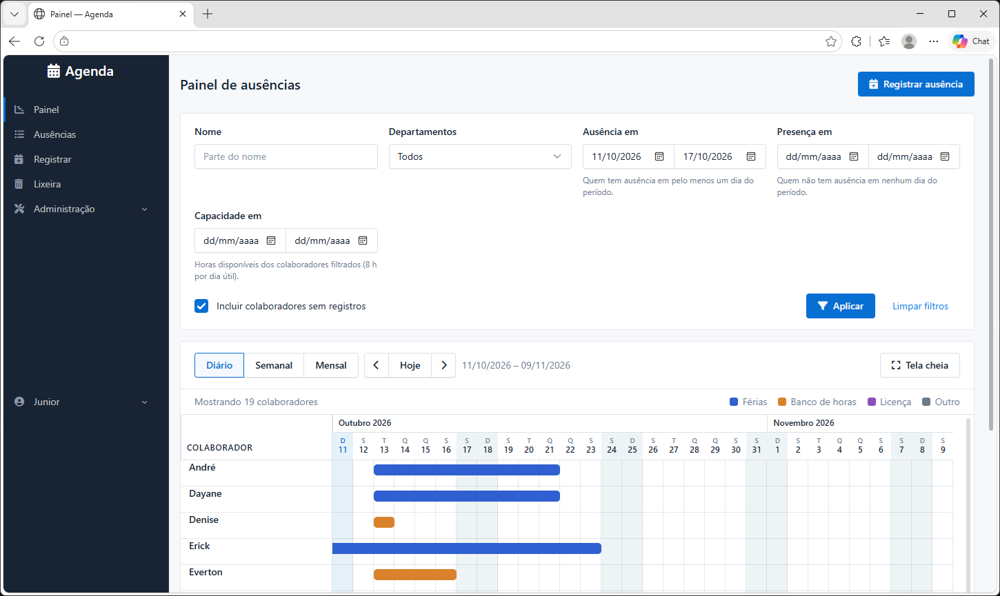

# Agenda

[](https://github.com/juniordiasjfd/agenda/actions/workflows/ci.yml)
[](#licença)

Sistema interno da Scriba para registrar e visualizar as ausências dos
colaboradores (férias, banco de horas, licença etc.). Substitui um fluxo
antigo baseado em HTML offline e planilhas CSV trocadas por e-mail.



## Funcionalidades

- **Painel Gantt**: escalas diária, semanal e mensal, tela cheia, cores por
  tipo de ausência e filtros por nome, departamento, "ausência em",
  "presença em" e capacidade disponível (horas úteis) num período.
- **Registro de ausências**: uma ausência com até 12 períodos, dias
  calculados na tela e bloqueio de sobreposição para o mesmo colaborador
  (inclusive na edição e na restauração).
- **Situações configuráveis** (Planejado, Aprovado, Realizado, Cancelado...),
  com controle de quais contam como ausência.
- **Listagem com filtros**, exclusão lógica e lixeira com restauração.
- **Importação e exportação CSV** compatíveis com os arquivos antigos, com
  etapa de prévia antes de gravar, detecção de duplicatas e sobreposições e
  CSV das linhas não importadas.
- **Usuários**: login por e-mail, autocadastro restrito a domínios
  permitidos com aprovação do administrador, convites por link,
  redefinição de senha e limite de tentativas de login.
- Interface em português (pt-BR), fuso America/Sao_Paulo.

## Tecnologias

- Python 3.11 e Django 5.2
- PostgreSQL
- Tabler UI, HTMX, Alpine.js e Font Awesome (sem SPA)
- pytest-django
- Hospedagem no Render (WhiteNoise, gunicorn), CI no GitHub Actions

## Como rodar localmente

Pré-requisitos: Python 3.11 e um PostgreSQL acessível (o usuário precisa
de permissão `CREATEDB` para os testes).

```bash
git clone https://github.com/juniordiasjfd/agenda.git
cd agenda
python -m venv .venv
source .venv/bin/activate        # Windows: .venv\Scripts\activate
pip install -r requirements.txt

cp .env.example .env             # ajuste SECRET_KEY e DATABASE_URL
python manage.py migrate
python manage.py createsuperuser
python manage.py runserver
```

Acesse <http://localhost:8000/>. Em desenvolvimento, os e-mails são
exibidos no console.

## Testes

```bash
pytest
```

O CI também executa `manage.py check`, `makemigrations --check` e
`check --deploy`.

## Estrutura

```
config/               settings, urls, wsgi
apps/core/            base de auditoria, permissões, utilitários
apps/usuarios/        usuário customizado, cadastro, aprovação, convites
apps/colaboradores/   departamentos e colaboradores
apps/ausencias/       tipos, situações, ausências, CSV, painel, lixeira
static/               CSS e JS do projeto (inclui o painel Gantt)
templates/            templates compartilhados
docs/deploy.md        runbook de deploy no Render
```

As regras de negócio ficam nos módulos `*_service.py`; as views são finas.

## Deploy

A infraestrutura está declarada em [`render.yaml`](render.yaml) (Blueprint
do Render). O passo a passo completo está em [`docs/deploy.md`](docs/deploy.md).

## Licença

Distribuído sob a licença [MIT License](https://opensource.org/licenses/MIT).
